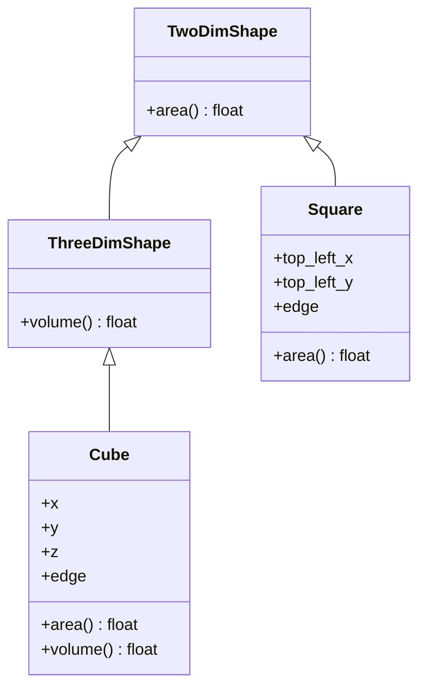
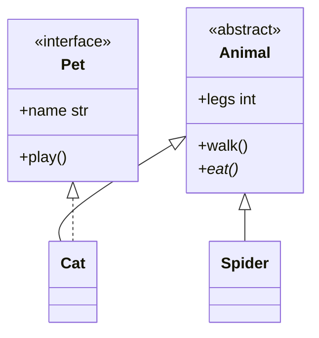

# Module 01: Object-Oriented Programming

[Course overview](../README.md) · [Module 02 →](../module02/README.md)

Object-oriented programming organises code around objects that bundle **state** (attributes) with **behaviour**
(methods). This module works through its three pillars:

1. **Encapsulation**, through classes and objects: an object guards its own state.
2. **Inheritance**, for reusability: a subclass reuses and specialises a base class.
3. **Polymorphism**: code written against a base class works with every subclass.

## Learning objectives

By the end of this module you can:

- hide an object's state behind properties and protect it with validation and business rules;
- explain what name mangling does, and what it does not do;
- build a class hierarchy, override methods, and rely on polymorphism instead of type checks;
- tell an interface from an abstract class, and enforce both with `abc.ABC`.

## Running the exercises

From the repository root:

```bash
uv run python module01/exercise01.py
```

## Exercises

### 1. Encapsulation: `exercise01.py`

An `Account` keeps its IBAN, balance and status private and lets the outside world reach them only in controlled ways.

- **Name mangling.** Attributes written as `self.__balance` are stored as `_Account__balance`, so `account.__balance`
  fails outside the class. This prevents accidental access and name clashes in subclasses, but it isn't real
  protection: `account._Account__balance` still works.
- **Properties.** `iban` has a getter and a setter. `balance` and `status` only have getters, which makes them
  read-only: the balance can change only through `deposit()` and `withdraw()`.
- **Validation rules vs. business rules.** `_validate_amount()` rejects amounts that are never valid (zero or
  negative). `withdraw()` adds a business rule: you can't take out more than the balance. Both raise `ValueError`.
- **`Enum`.** `AccountStatus` limits the status to `ACTIVE`, `CLOSED` or `BLOCKED` instead of any string.
- **`__str__`.** `print(account)` calls `str(account)`, which calls `account.__str__()`.

Expected output:

```text
300
Account [iban: tr3, balance: 300, status: ACTIVE]
Account [iban: tr2, balance: 0.0, status: BLOCKED]
```

Notice `300` against `0.0`. `acc1` was opened with the int `1_000`, `acc2` with the default float `0.0`. The
`float` type hint documents intent, but Python doesn't enforce hints at runtime.

### 2. Inheritance and polymorphism: `exercise02.py`



- The base classes declare `area()` and `volume()` but raise `NotImplementedError`; the subclasses **override**
  them with real formulas. `ThreeDimShape` inherits from `TwoDimShape`, so every 3-D shape also has an `area()` (its
  surface area).
- The loop in `main()` calls `shape.area()` without knowing which class it holds. Python looks the method up on the
  object's own class at call time. That is **polymorphism**.
- Only 3-D shapes have `volume()`, so the loop checks with `isinstance(shape, ThreeDimShape)`. `isinstance` respects
  inheritance: a future `Sphere(ThreeDimShape)` would pass the check with no changes to the loop.

Expected output:

```text
Square [x: 100, y: 200, edge: 100] 10000
Square [x: 200, y: 300, edge: 200] 40000
Square [x: 300, y: 400, edge: 300] 90000
Cube [x: 100, y: 200, z: 100, edge: 2] 24.0
8
```

### 3. Interfaces and abstract classes: `exercise03.py`



- **Interface.** Python has no `interface` keyword. An ABC whose members are all abstract plays that role: `Pet`
  only says that a pet has a `name` (an abstract property with a setter) and can `play()`.
- **Abstract class.** `Animal` mixes shared state (`legs`), a concrete method (`walk()`) and an abstract one
  (`eat()`) that every animal must implement.
- **Fail early.** An ABC refuses to create an instance while any abstract member is missing, so `Animal(4)` raises
  `TypeError` immediately, not later when `eat()` is first called.
- **Multiple inheritance.** `Cat(Animal, Pet)` is both. Its method resolution order (MRO) is
  `Cat → Animal → Pet → ABC → object`, which is why `super().__init__(legs=4)` reaches `Animal.__init__`.

Expected output:

```text
Animal with 8 legs is walking now...
Spider is eating now...
Animal with 4 legs is walking now...
Garfield is eating now...
Garfield is playing now...
Animal with 4 legs is walking now...
Tekir is eating now...
Tekir is playing now...
Animal with 8 legs is walking now...
Spider is eating now...
```

## Key takeaways

- Expose state through properties, and leave out the setter to make it read-only.
- Name mangling prevents accidents, not access. Python's privacy is a convention: a leading `_` means "internal".
- Prefer polymorphism to type checks. When you do need a check, use `isinstance()`, not `type(x) == ...` or `dir()`.
- Use ABCs so that a missing implementation fails when the object is created, not deep inside a later call.

## Try it

1. In `exercise01.py`, add `acc1.balance -= 1_000_000`. You get
   `AttributeError: property 'balance' of 'Account' object has no setter`.
2. Print `acc1._Account__balance` to see the mangled name at work, then try `acc1.__balance`.
3. Call `acc1.withdraw(5_000)` and read the business-rule error.
4. Add a `Circle(TwoDimShape)` with a `radius` to `exercise02.py` (`area = math.pi * radius ** 2`) and put one in the
   list. The loop in `main()` needs no change.
5. In `exercise03.py`, call `Animal(4)`, or delete `Cat.play`, and read the `TypeError`.
6. Print `[cls.__name__ for cls in Cat.__mro__]` to see the method resolution order.

## Further reading

- [Python tutorial: Classes](https://docs.python.org/3/tutorial/classes.html)
- [`property`](https://docs.python.org/3/library/functions.html#property)
- [`enum`: support for enumerations](https://docs.python.org/3/library/enum.html)
- [`abc`: abstract base classes](https://docs.python.org/3/library/abc.html)
