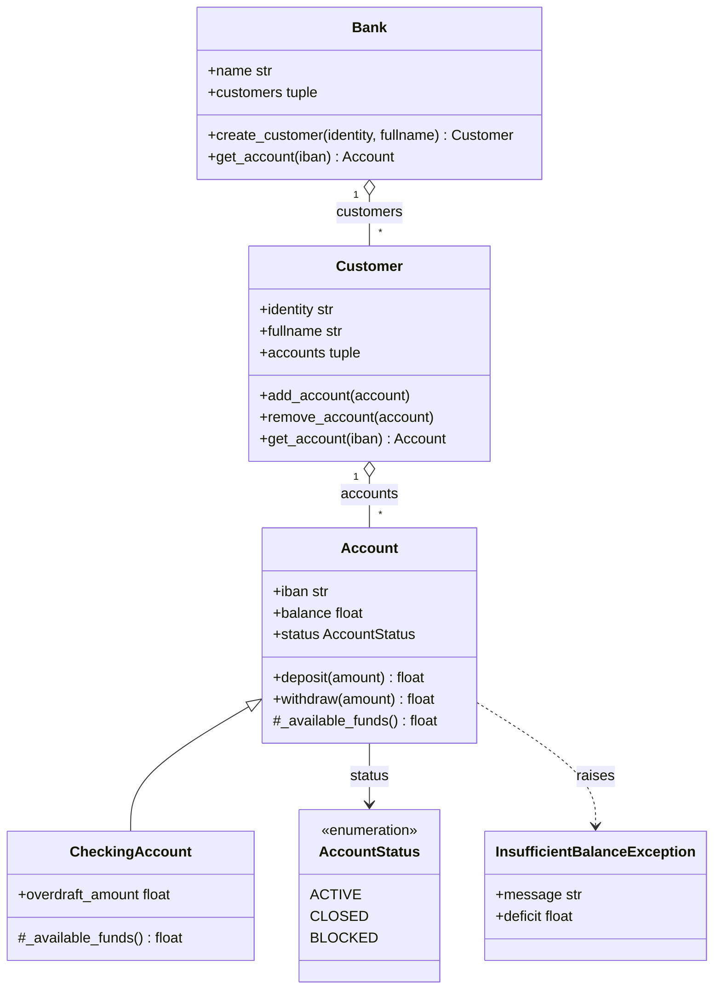

# Module 03: Unit Testing

[← Module 02](../module02/README.md) · [Course overview](../README.md) · [Module 04 →](../module04/README.md)

**Lecture notes:** [Unit Testing in Python Using pytest](../lecture-notes/module03-unit.testing.in.python.using.pytest.pdf) (PDF)

A **unit test** checks one small unit of code, usually a class or a function, automatically and in isolation. A
good suite catches regressions the moment they appear and documents how the code is meant to behave. This module
pairs a small banking domain, the [`banking`](banking) package, with a [pytest](https://docs.pytest.org/) suite in
[`tests/`](tests).

## Learning objectives

By the end of this module you can:

- structure a test in four phases: setup, exercise, verify, teardown;
- use fixtures for setup, parametrization to run one test over many inputs, and `pytest.raises` for expected errors;
- isolate the unit under test by replacing its collaborators with mocks;
- measure line and branch coverage, and explain what coverage does and doesn't prove.

## Running the tests

pytest reads its settings from the repository's `pyproject.toml`, so these commands work from anywhere in the
repository:

```bash
uv run pytest                                   # the whole suite
uv run pytest -v                                # one line per test
uv run pytest module03/tests/test_bank.py       # a single file
uv run pytest -k overdraft                      # only tests whose name contains "overdraft"
```

The tests import the package as `module03.banking`. The `pythonpath` setting in `pyproject.toml` puts the
repository root on the import path, which is what makes that work.

## The code under test



`Bank.get_account` and `Customer.get_account` return `None` when no account has the given IBAN. `customers` and
`accounts` return tuple copies, so callers can't change a bank's or a customer's internal list.

### Business rules

| Rule | Checked by | Failure |
|---|---|---|
| Only `ACTIVE` accounts accept transactions | `deposit()`, `withdraw()` | `ValueError("Account is not active")` |
| Amounts must be positive | `deposit()`, `withdraw()` | `ValueError("Amount must be positive")` |
| A withdrawal can't exceed the available funds | `withdraw()` | `InsufficientBalanceException`, with the shortfall in `deficit` |
| A status must be an `AccountStatus` | the `status` setter | `ValueError` |
| An overdraft must be positive | the `overdraft_amount` setter | `ValueError` |

For an `Account`, the available funds are the balance. A `CheckingAccount` adds its overdraft, so its balance can go
negative, down to `-overdraft_amount`.

### Design note: one hook instead of a copied method

`Account.withdraw()` asks `self._available_funds()` how much may be withdrawn, and `CheckingAccount` overrides only
that one method. Validation, the deficit calculation and the balance update stay in a single place. Copying the whole
of `withdraw()` into the subclass would mean fixing every future bug twice.

## The test suite

| File | Unit under test | Techniques |
|---|---|---|
| [`test_account.py`](tests/test_account.py) | `Account`, `CheckingAccount` | the four phases, fixtures, parametrization, `pytest.raises` |
| [`test_customer.py`](tests/test_customer.py) | `Customer` | fixtures that build on other fixtures |
| [`test_bank.py`](tests/test_bank.py) | `Bank` | isolation with pytest-mock |

### The four test phases

```python
@pytest.fixture
def an_active_account():                                         # 1. setup
    return Account("TR1", 1_000, AccountStatus.ACTIVE)


def test_withdraw_over_balance_should_fail_with_deficit(an_active_account):
    with pytest.raises(InsufficientBalanceException) as exc_info:   # 3. verify that...
        an_active_account.withdraw(1_200)                           # 2. ...exercising the method fails
    assert exc_info.value.deficit == 200                            # 3. verify the details
    assert an_active_account.balance == 1_000                       #    and that nothing changed
```

The fourth phase, **teardown**, isn't needed here because nothing outside memory is touched. A fixture that opens a
file or a connection would `yield` its value instead of returning it and put the cleanup code after the `yield`.

### Fixtures

pytest looks at a test's parameter names and passes in the fixture with the same name. Fixtures are rebuilt for every
test, so one test can never leave data behind for the next. A fixture can depend on others: in `test_customer.py`,
`a_customer` asks for `two_accounts`.

### Parametrization

```python
@pytest.mark.parametrize("amount", non_positive_amounts)
def test_deposit_with_non_positive_amount_should_fail(an_active_account, amount):
```

This single function runs once per value and is reported as separate tests, such as
`test_deposit_with_non_positive_amount_should_fail[-1.1]`. When one input fails, you can see exactly which.

### Testing exceptions

`pytest.raises(SomeError)` fails the test unless the block raises `SomeError`. Add `match="..."` to check the message
(a regular expression searched in `str(error)`), and use `as exc_info` to inspect the exception object afterwards.

### Isolation with mocks

`Bank.get_account()` asks each customer in turn. If a `Bank` test used real customers, a bug in `Customer` would make
the `Bank` tests fail too, hiding where the problem really is. The `a_bank` fixture therefore replaces each customer's
`get_account` with a mock:

```python
mocker.patch.object(customer, "get_account", side_effect=accounts.get)
```

With a function as its `side_effect`, the mock calls it with the same arguments and returns its result. `dict.get`
returns `None` for a missing key, which is exactly the contract of the real `get_account`. pytest-mock undoes every
patch when the test ends.

### Naming convention

Tests are named `test_<situation>_should_<expected outcome>`, as in
`test_get_account_with_unknown_iban_should_return_none`. When a test fails, its name already reads like a bug report.

## Coverage

```bash
uv run pytest --cov=module03/banking --cov-branch --cov-report=term-missing
```

```text
Name                           Stmts   Miss Branch BrPart  Cover   Missing
--------------------------------------------------------------------------
module03\banking\__init__.py       4      0      0      0   100%
module03\banking\account.py       65      0     10      0   100%
module03\banking\bank.py          19      0      0      0   100%
module03\banking\customer.py      24      0      0      0   100%
--------------------------------------------------------------------------
TOTAL                            112      0     10      0   100%
```

(That's the Windows output. Paths use `/` on macOS and Linux.)

- **Line coverage** asks whether every statement ran. **Branch coverage** also asks whether every `if` went both
  ways. `BrPart` counts branches that were taken only one way.
- Lines no test reaches appear in the `Missing` column. Use `--cov-report=html` and open `htmlcov/index.html` to see
  them highlighted in the source.
- 100% coverage proves every line **ran**, not that every behaviour is **checked**: a test without assertions also
  counts. The first experiment below shows why the assertions matter.

## Key takeaways

- Keep each test small, independent and named after the behaviour it checks.
- Use fixtures for setup and parametrization for "the same test, different inputs".
- Test failure paths as carefully as success paths: business rules live in the errors.
- Mock collaborators to keep a failure pointing at one unit.
- Treat coverage as a map of untested code, not as a measure of quality.

## Try it

1. In `banking/account.py`, change `amount > available` to `amount >= available` in `withdraw()` and run the
   suite. Three tests catch the off-by-one, among them `test_withdraw_should_decrease_balance`.
2. Make `Customer.get_account()` always return `None`. The `Customer` tests fail, but the `Bank` tests still pass:
   the mocks keep them isolated.
3. Re-run the coverage command with `--ignore=module03/tests/test_customer.py` added. `customer.py` drops to 79%, and
   the `Missing` column lists the lines only those tests reach.
4. Practise test-first development. Write failing tests for a new `Bank.transfer(source_iban, target_iban, amount)`
   (a successful transfer, an unknown IBAN, insufficient funds), then write the method that makes them pass.

## Further reading

- [pytest: fixtures](https://docs.pytest.org/en/stable/how-to/fixtures.html),
  [parametrize](https://docs.pytest.org/en/stable/how-to/parametrize.html) and
  [assertions about expected exceptions](https://docs.pytest.org/en/stable/how-to/assert.html#assertions-about-expected-exceptions)
- [pytest-mock](https://pytest-mock.readthedocs.io/) and [`unittest.mock`](https://docs.python.org/3/library/unittest.mock.html)
- [pytest-cov](https://pytest-cov.readthedocs.io/) and [Coverage.py: branch coverage](https://coverage.readthedocs.io/en/latest/branch.html)
